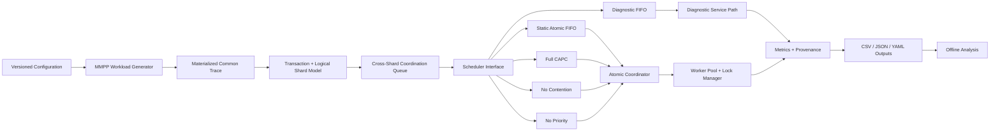

<div align="center">

# CAPC Simulator

### Contention-Aware Priority Coordination for Atomic Cross-Shard Blockchain Scheduling under Burst-Driven IoT Workloads


**Executable research artefact for an MSc thesis on blockchain scalability for time-sensitive IoT applications.**

</div>

---

## Overview

This repository implements **CAPC (Contention-Aware Priority Coordination)**, a deterministic scheduling-layer mechanism for pending atomic cross-shard transactions in a logically sharded blockchain model.

The research question is deliberately narrow: when burst-driven IoT workloads create contention for finite cross-shard coordination capacity, can service order be made responsive to **contention, urgency, waiting age, dependency burden, and recent shard-lock pressure** without changing the atomic service semantics used by the matched baseline?

The simulator provides:

- two-state **Markov-Modulated Poisson Process (MMPP)** workload generation;
- logical shards and one-/two-/three-shard transaction footprints;
- finite cross-shard coordination workers;
- all-or-nothing shard locking for matched atomic treatments;
- a common scheduler interface;
- Static Atomic FIFO, full CAPC, two CAPC ablations, and Diagnostic FIFO;
- deterministic paired workload replay across treatments;
- transaction-, event-, queue-, and decision-level logging;
- neutral-pilot, verification, matrix execution, and analysis utilities;
- run-level provenance for reproducible thesis experiments.

> [!IMPORTANT]
> This repository currently represents an **implementation, verification, and experiment-readiness artefact**. The primary CAPC parameter set has been frozen after scheduler-neutral Static Atomic FIFO calibration. Verification and neutral-pilot outputs are **not CAPC comparative performance findings**.

---

## Research boundary

CAPC changes **service order only**. It does not redesign consensus, shard formation, validator assignment, networking, or atomic commit semantics.

For the matched atomic treatments, a transaction can enter service only when:

1. a coordination worker is free; and
2. all required logical shards are simultaneously available.

A waiting transaction never holds a partial subset of its required locks. After dispatch, coordination service is non-preemptive.

### Scheduler treatments

| Treatment | Role | Selection rule |
|---|---|---|
| **Diagnostic FIFO** | Descriptive reference | Oldest waiting cross-shard request; non-atomic comparison path |
| **Static Atomic FIFO** | Principal matched baseline | Earliest-arriving currently eligible transaction |
| **Full CAPC** | Proposed scheduler | Highest CAPC score among eligible transactions |
| **CAPC-No-Contention** | Ablation | Full CAPC with contention amplification disabled |
| **CAPC-No-Priority** | Ablation | Full CAPC with urgency contribution disabled |

Diagnostic FIFO is intentionally excluded from the primary causal matched comparison because it does not share the same atomic eligibility semantics.

---

## CAPC decision model

CAPC first performs atomic eligibility filtering. Only currently eligible transactions are ranked.

```text
S_i(t) = w_U U_i + w_A A_i(t)
         + [1 + gamma C(t)]
           [w_D (1 - D_i) + w_H (1 - H_i(t))]
```

where:

- `C(t)` = normalized global contention score;
- `U_i` = urgency (`Low=0`, `Medium=0.5`, `High=1`);
- `A_i(t)` = bounded monotonic waiting-age contribution;
- `D_i` = normalized shard-dependency burden;
- `H_i(t)` = recent lock-pressure over the transaction's required shards.

The instantaneous active-lock conflict count `K_i(t)` is used for **eligibility** and RQ2 logging. It is not used as an additive post-filter ranking term because every eligible transaction has `K_i(t)=0` at the selection instant.

Deterministic tie-breaking is:

```text
higher CAPC score
→ greater waiting age
→ earlier arrival / queue entry
→ lower transaction ID
```

---

## Architecture



The workload, model, scheduler, coordination, metrics, experiment, and analysis layers are separated so that changing the scheduler cannot silently change the exogenous workload or service model.

---

## Repository structure

```text
capc-simulator/
├── .github/workflows/tests.yml
├── configs/
│   ├── dev.yaml
│   ├── primary.yaml
│   └── primary_template.yaml
├── docs/
│   ├── COMPONENTS.md
│   ├── DEVELOPMENT_VERIFICATION.md
│   ├── END_TO_END_WORKFLOW.md
│   ├── EXPERIMENT_PROTOCOL.md
│   ├── GITHUB_SETUP.md
│   ├── OUTPUT_SCHEMA.md
│   ├── PARAMETER_FREEZE.md
│   ├── RESEARCH_INTEGRITY.md
│   ├── THESIS_TRACEABILITY.md
│   └── VERIFICATION.md
├── examples/sample_output/
├── scripts/
├── src/capc_sim/
│   ├── analysis/
│   ├── config/
│   ├── coordinator/
│   ├── experiments/
│   ├── metrics/
│   ├── model/
│   ├── scheduler/
│   ├── simulation/
│   └── workload/
├── tests/
│   ├── integration/
│   ├── regression/
│   └── unit/
├── CITATION.cff
├── LICENSE-NOTICE.md
├── pyproject.toml
├── requirements.txt
└── README.md
```

See [`docs/COMPONENTS.md`](docs/COMPONENTS.md) for component-by-component responsibilities and research traceability.

---

## Installation

```bash
git clone https://github.com/rhidoyhasanmahmud/capc-simulator.git
cd capc-simulator

python -m venv .venv
source .venv/bin/activate        # macOS / Linux
# .venv\Scripts\Activate.ps1    # Windows PowerShell

python -m pip install --upgrade pip
pip install -e ".[dev]"
```

Python **3.11+** is required.

---

## Automated tests

```bash
pytest
```

Development verification snapshot:

```text
...............................                                          [100%]
31 passed
```

The test suite covers configuration gating, deterministic workload generation, queue/lock semantics, scheduler behaviour, CAPC scoring, aging, paired trace equality, event flow, accounting, state-series calculations, paired starvation analysis, and preservation checks.

---

## Chapter 5 verification

```bash
capc-sim verify \
  --config configs/dev.yaml \
  --json-output results/verification.json
```

The implementation verification matrix covers:

```text
V1   Trace reproducibility
V2   Cross-treatment trace equality
V3   Static Atomic FIFO ordering
V4   Diagnostic FIFO ordering
V5   Matched-atomic lock exclusion
V6   All-or-nothing lock release
V7   Multi-worker dispatch
V8   CAPC score hand-check
V9   Aging monotonicity
V10  Transaction accounting
V11  Low-load sanity
V12  Overload stress queue growth
```

Current development verification: **V1-V12 PASS**.

> A verification PASS demonstrates consistency with the declared simulator design. It does not demonstrate that CAPC outperforms the baseline.

---

## Runtime optimization validation

Before the neutral thesis pilot, the primary-mode execution path was profiled and two implementation-only optimizations were applied:

- exhaustive simulator invariants remain enabled for development/verification runs, while large primary runs use periodic checks plus cutoff and final-state validation;
- exact piecewise-constant queue integrals use a cumulative-area representation instead of repeatedly rescanning all state breakpoints.

These changes do **not** alter workload generation, scheduling rules, lock semantics, service times, random seeds, recorded metrics, or the experimental design.

Validation evidence for the reference Static Atomic FIFO run:

```text
Automated tests                 31/31 PASS
Chapter 5 verification          V1-V12 PASS
Pre/post summary comparison     PASS (equivalent within 1e-12)
Reference runtime               44.26 s -> 10.19 s
Representative high-contention  14.70 s
```

The reference runtime reduction is approximately **77%** (about **4.34x faster**). These measurements are engineering/readiness evidence only; they are **not CAPC performance findings** and are not used to select CAPC parameters.

---

## Run one development simulation

```bash
capc-sim run \
  --config configs/dev.yaml \
  --scheduler capc \
  --seed 1 \
  --output results/dev
```

Each run preserves raw and derived evidence such as:

```text
trace.csv
workload_states.csv
transactions.csv
decisions.csv
dispatch_snapshots.csv
state_events.csv
summary.json
queue_recovery.json
metadata.json
effective_config.yaml
```

`metadata.json` records configuration and trace hashes, Git revision when available, Python/runtime details, platform and machine information, processor, best-effort physical memory, package versions, and cutoff state.

---

## Run a paired matrix

```bash
capc-sim matrix \
  --config configs/dev.yaml \
  --seeds 1 \
  --shards 4 \
  --ratios 0.30 \
  --workers 2 \
  --output results/dev_matrix
```

The matrix runner generates one exogenous trace for each condition/seed and replays it across the selected treatments. `pair_integrity.csv` records whether paired scheduler runs use the same trace hash.

---

## Neutral pilot

The neutral pilot runs **Static Atomic FIFO only**, avoiding labelled CAPC performance when checking experimental readiness.

```bash
capc-sim pilot \
  --config configs/dev.yaml \
  --seeds 1 2 3 4 5 \
  --shards 4 8 16 \
  --ratios 0.10 0.30 0.50 \
  --workers 2 4 \
  --output results/pilot
```

It additionally writes:

- `pilot_regime_summary.csv`;
- `pilot_acceptance.json`.

The completed thesis neutral pilot used Static Atomic FIFO only across 90 runs (5 seeds × 18 shard/ratio/worker conditions). It produced 16 LOW, 54 TRANSITIONAL, and 20 HIGH classifications, so the predeclared contention-regime coverage criterion passed. These outputs were used only for scheduler-neutral readiness and normalization calibration; they are not CAPC performance findings.

---

## Deterministic matrix post-processing

After a paired matrix completes:

```bash
capc-sim analyze \
  --config configs/dev.yaml \
  --matrix-dir results/dev_matrix
```

The analysis stage writes:

- `analysis/starvation_by_run.csv`;
- `analysis/matrix_summary_enriched.csv`;
- `analysis/capc_vs_baseline_preservation.csv`;
- `analysis/analysis_manifest.json`.

The starvation threshold is derived separately for each condition/seed from the matched Static Atomic FIFO waiting distribution:

```text
max(0.50 s, 5 × paired-baseline median waiting time)
```

The same threshold is then applied to paired treatments. The preservation table evaluates the predeclared practical limits for p99 reduction, throughput, Jain's completion-ratio index, starvation incidence, low-priority p95 waiting time, and queue stability.

This deterministic table does **not** declare overall CAPC success; the final decision also requires the predeclared paired uncertainty analysis across seeds.

---

## Primary thesis experiment design

| Factor | Levels |
|---|---|
| Logical shards | `4`, `8`, `16` |
| Cross-shard ratio | `0.10`, `0.30`, `0.50` |
| Coordination workers | `2`, `4` |
| Scheduler treatments | `5` |
| Seeds | frozen `1..N` |

The main matrix is therefore:

```text
3 × 3 × 2 × 5 × N = 90N runs
```

The final replication count is selected from the predeclared candidate set `{30, 40, 50, 60}` using Static Atomic FIFO baseline log-p99 precision and frozen before labelled comparative inference.

---

## Configuration integrity

### `configs/dev.yaml`

For software development, debugging, smoke runs, and verification only. Its CAPC values are **not automatically the thesis parameter set**.

### `configs/primary.yaml`

Contains the frozen primary experiment configuration. The CAPC parameters were frozen after scheduler-neutral Static Atomic FIFO calibration and before labelled CAPC comparative experimentation.

Current primary configuration SHA-256:

`be25b6dc8c89c3a49b891ea4c69e1c1dfe38b6e117d577bd8026c2d0094ba875`

See [`docs/PARAMETER_FREEZE.md`](docs/PARAMETER_FREEZE.md) for the calibration evidence, freeze rationale, and research-integrity boundary.

### `configs/primary_template.yaml`

Contains the methodology-level experiment structure with CAPC numerical values intentionally left as `null`. It remains a template rather than the executable frozen primary parameter set.

This separation prevents development placeholders from silently becoming final thesis settings.

---

## Statistical-analysis support

The analysis layer includes helpers for:

- paired treatment-baseline tables;
- 10,000-resample paired bootstrap confidence intervals;
- Holm adjustment for planned contrasts;
- paired Wilcoxon fallback;
- the primary log-p99 mixed-effects model;
- the RQ2 waiting-time mixed-effects model using Static Atomic FIFO transactions from the arrival-based measurement window.

Final statistical conclusions are intentionally reserved for the frozen primary dataset.

---

## Reproducibility controls

The repository enforces or records:

- treatment-independent workload generation;
- deterministic separate random streams;
- common trace replay across schedulers;
- deterministic tie-breaking;
- all-or-nothing atomic locks for matched treatments;
- immutable transaction shard sets and service requirements;
- configuration and trace hashes;
- source revision when available;
- raw data before aggregation;
- failed-run logging without silent replacement seeds;
- fixed CAPC parameters during final comparative runs.

---

## Model limitations

This is a **controlled logical discrete-event simulator**, not a production blockchain implementation. It intentionally abstracts away validator committees, consensus execution, peer-to-peer topology, cryptographic cost, smart-contract execution, physical IoT communication, and production-specific failure/retry semantics outside the declared coordination model.

These are research-boundary exclusions rather than missing software features.

---

## Documentation

| Document | Purpose |
|---|---|
| [`COMPONENTS.md`](docs/COMPONENTS.md) | Component responsibilities and implementation design |
| [`THESIS_TRACEABILITY.md`](docs/THESIS_TRACEABILITY.md) | Thesis requirement → code component → evidence |
| [`VERIFICATION.md`](docs/VERIFICATION.md) | V1-V12 verification matrix |
| [`DEVELOPMENT_VERIFICATION.md`](docs/DEVELOPMENT_VERIFICATION.md) | Development verification evidence |
| [`END_TO_END_WORKFLOW.md`](docs/END_TO_END_WORKFLOW.md) | Verification → pilot → matrix → analysis workflow |
| [`EXPERIMENT_PROTOCOL.md`](docs/EXPERIMENT_PROTOCOL.md) | Experimental protocol summary |
| [`OUTPUT_SCHEMA.md`](docs/OUTPUT_SCHEMA.md) | Raw outputs and provenance schema |
| [`RESEARCH_INTEGRITY.md`](docs/RESEARCH_INTEGRITY.md) | Guardrails against post-hoc tuning and unsupported claims |
| [`PARAMETER_FREEZE.md`](docs/PARAMETER_FREEZE.md) | Neutral calibration evidence and frozen primary CAPC configuration |
| [`GITHUB_SETUP.md`](docs/GITHUB_SETUP.md) | Repository publication/setup guidance |

---

## Current status

| Item | Status |
|---|---|
| Core discrete-event simulator | ✅ Implemented |
| Five scheduler treatments | ✅ Implemented |
| Paired workload replay | ✅ Implemented |
| Atomic lock/worker coordination | ✅ Implemented |
| Raw metrics and provenance | ✅ Implemented |
| Paired starvation/preservation analysis | ✅ Implemented |
| Neutral-pilot regime reporting | ✅ Implemented |
| Automated tests | ✅ 31 passed in development verification |
| Chapter 5 V1-V12 checks | ✅ PASS |
| Primary-run runtime optimization | ✅ Validated with equivalent summary outputs |
| Final CAPC parameter freeze | ✅ Frozen and verified |
| Neutral thesis pilot | ✅ 90 Static Atomic FIFO runs; regime coverage PASS |
| Final replication count `N` | ⏳ Pending baseline precision check |
| Main `90N` research matrix | ⏳ Not executed |
| CAPC performance conclusions | ⏳ Not established |

**Implementation evidence precedes performance evidence.**

---

## Citation

A [`CITATION.cff`](CITATION.cff) file is included for citation of the research software artefact.

## Licence

No open-source licence is automatically asserted by this research snapshot. See [`LICENSE-NOTICE.md`](LICENSE-NOTICE.md) before selecting a licence, and confirm university/publication requirements first.

## Author

**Hasan Mahmud Rhidoy**  
MSc by Research — Computer Science  
Research area: blockchain scalability, sharded blockchain coordination, and time-sensitive IoT workloads

---

<div align="center">

**CAPC is a scheduling-layer research mechanism: the code implements the mechanism; the frozen experiments determine whether the hypothesis is supported.**

</div>
