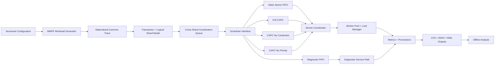

<div align="center">

# CAPC Simulator

### Contention-Aware Priority Coordination for Atomic Cross-Shard Blockchain Scheduling under Burst-Driven IoT Workloads


**Executable research artefact for an MSc thesis on blockchain scalability for time-sensitive IoT applications.**

</div>

---

## Overview

This repository implements **CAPC (Contention-Aware Priority Coordination)**, a scheduling-layer mechanism for atomic cross-shard transactions in a logically sharded blockchain model.

The research problem is narrow by design: when burst-driven IoT workloads create contention for a finite cross-shard coordination service, can transaction service order be made more responsive to **contention, urgency, waiting age, dependency burden, and recent shard-lock pressure** while preserving the same atomic coordination semantics as the matched baseline?

The simulator provides the executable implementation boundary required by the thesis methodology:

- two-state **Markov-Modulated Poisson Process (MMPP)** workload generation;
- logical shards and multi-shard transaction dependencies;
- finite coordination workers;
- all-or-nothing shard locking for matched atomic treatments;
- interchangeable scheduling policies behind a common interface;
- full CAPC and two ablation variants;
- paired workload traces across treatments;
- transaction-level observability and run provenance;
- verification, pilot, experiment-matrix, and analysis utilities.

> [!IMPORTANT]
> The current repository snapshot is an **implementation and verification artefact**. Development parameters are included so that the software can be executed and tested, but the final CAPC numerical parameters are intentionally not treated as frozen thesis parameters. The verification outputs shown in this README are **not CAPC performance results**.

---

## Research scope

CAPC changes **only the service-order decision** among pending cross-shard transactions. It does not redesign consensus, shard formation, validator assignment, networking, or atomic commit semantics.

For the matched atomic treatments, a transaction may start service only when:

1. a coordination worker is free; and
2. **all** of its required shards are currently unlocked.

Waiting transactions never hold partial shard locks, and service is non-preemptive after dispatch.

### Scheduler treatments

| Treatment | Role | Selection rule |
|---|---|---|
| **Diagnostic FIFO** | Descriptive reference only | Oldest waiting cross-shard request; not part of the matched atomic causal comparison |
| **Static Atomic FIFO** | Principal matched baseline | Earliest-arriving currently eligible transaction |
| **Full CAPC** | Proposed scheduler | Maximum CAPC score among eligible transactions |
| **CAPC-No-Contention** | Ablation | Full CAPC with contention amplification disabled |
| **CAPC-No-Priority** | Ablation | Full CAPC with urgency contribution disabled |

---

## CAPC decision model

CAPC first filters the queue using instantaneous lock eligibility. Only eligible transactions are ranked.

For eligible transaction `i` at time `t`:

```text
S_i(t) = w_U U_i + w_A A_i(t)
         + [1 + gamma C(t)]
           [w_D (1 - D_i) + w_H (1 - H_i(t))]
```

where:

- `C(t)` — normalized global contention score;
- `U_i` — urgency value (`Low=0`, `Medium=0.5`, `High=1`);
- `A_i(t)` — bounded monotonic waiting-age score;
- `D_i` — normalized dependency burden;
- `H_i(t)` — recent lock pressure over the transaction's required shards.

The instantaneous active-lock conflict count `K_i(t)` is used for **eligibility** and for RQ2 logging. It is deliberately not used as an additive ranking term after eligibility filtering, because every eligible transaction necessarily has `K_i(t)=0` at that instant.

Tie-breaking is deterministic:

```text
higher CAPC score
    -> greater waiting age
    -> earlier arrival / queue entry
    -> lower transaction ID
```

---

## Architecture



The implementation deliberately separates **workload**, **model**, **scheduler**, **coordination**, **measurement**, and **analysis** layers. This prevents a scheduler implementation from silently changing the workload or service semantics.

---

## Repository structure

```text
capc-sim/
├── .github/
│   └── workflows/
│       └── tests.yml
├── configs/
│   ├── dev.yaml
│   └── primary_template.yaml
├── docs/
│   ├── COMPONENTS.md
│   ├── DEVELOPMENT_VERIFICATION.md
│   ├── EXPERIMENT_PROTOCOL.md
│   ├── GITHUB_SETUP.md
│   ├── OUTPUT_SCHEMA.md
│   ├── RESEARCH_INTEGRITY.md
│   ├── THESIS_TRACEABILITY.md
│   └── VERIFICATION.md
├── examples/
│   └── sample_output/
├── scripts/
├── src/
│   └── capc_sim/
│       ├── analysis/
│       ├── config/
│       ├── coordinator/
│       ├── experiments/
│       ├── metrics/
│       ├── model/
│       ├── scheduler/
│       ├── simulation/
│       └── workload/
├── tests/
│   ├── integration/
│   ├── regression/
│   └── unit/
├── .gitignore
├── CITATION.cff
├── LICENSE-NOTICE.md
├── MANIFEST.sha256
├── pyproject.toml
├── requirements.txt
└── README.md
```

A file-by-file explanation of the implementation is available in **[`docs/COMPONENTS.md`](docs/COMPONENTS.md)**.

---

## Quick start

### 1. Clone and enter the repository

```bash
git clone <your-github-repository-url>
cd capc-sim
```

### 2. Create a virtual environment

```bash
python -m venv .venv
```

Activate it:

```bash
# macOS / Linux
source .venv/bin/activate

# Windows PowerShell
.venv\Scripts\Activate.ps1
```

### 3. Install the project

```bash
python -m pip install --upgrade pip
pip install -e ".[dev]"
```

Python **3.11+** is required.

### 4. Run the automated test suite

```bash
pytest
```

Verified output for this packaged source snapshot:

```text
.............................                                            [100%]
29 passed
```

---

## Chapter 5 implementation verification

The repository includes deterministic checks corresponding to the thesis implementation-verification matrix.

Run:

```bash
capc-sim verify \
  --config configs/dev.yaml \
  --json-output results/verification.json
```

Verified output from this source snapshot:

```text
PASS V1   Trace reproducibility
PASS V2   Cross-treatment trace equality
PASS V3   Static Atomic FIFO earliest eligible
PASS V4   Diagnostic FIFO raw queue order
PASS V5   Matched-atomic lock exclusion
PASS V6   All-or-nothing lock release
PASS V7   Multi-worker dispatch
PASS V8   CAPC score hand-check
PASS V9   Aging monotonicity
PASS V10  Transaction accounting
PASS V11  Low-load sanity
PASS V12  Overload stress queue growth

Overall: PASS
```

Machine-readable example: [`examples/sample_output/verification.json`](examples/sample_output/verification.json).

> [!NOTE]
> A verification PASS means that the software behaves consistently with the declared simulation model and invariants. It does **not** demonstrate that CAPC outperforms Static Atomic FIFO.

---

## Run a development simulation

```bash
capc-sim run \
  --config configs/dev.yaml \
  --scheduler capc \
  --seed 1 \
  --output results/dev
```

A run creates a directory similar to:

```text
results/dev/sh4_x30_w2_capc_seed001/
├── decisions.csv
├── dispatch_snapshots.csv
├── effective_config.yaml
├── metadata.json
├── queue_recovery.json
├── state_events.csv
├── summary.json
├── trace.csv
├── transactions.csv
└── workload_states.csv
```

These files preserve the raw evidence needed to reconstruct run-level latency, queue, throughput, fairness, starvation, stability, and RQ2 predictor analyses.

---

## Run a paired five-treatment smoke matrix

```bash
capc-sim matrix \
  --config configs/dev.yaml \
  --seeds 1 \
  --shards 4 \
  --ratios 0.30 \
  --workers 2 \
  --output results/dev_matrix
```

Verified console output:

```text
Completed 5 runs. Summary: results/dev_matrix/matrix_summary.csv
```

The matrix writes `pair_integrity.csv`. A valid paired run must show the same exogenous trace hash across all scheduler treatments.

Verified paired-trace integrity example:

```text
shard_count,cross_shard_ratio,workers,seed,paired_trace_equal
4,0.3,2,1,True
```

This check is important because scheduler-specific random-number consumption must never alter arrivals, priorities, required shards, or service requirements.

---

## Neutral pilot

The neutral pilot runs **Static Atomic FIFO only**. This keeps readiness and replication decisions independent of labelled CAPC performance.

```bash
capc-sim pilot \
  --config configs/dev.yaml \
  --seeds 1 2 3 4 5 \
  --shards 4 8 16 \
  --ratios 0.10 0.30 0.50 \
  --workers 2 4 \
  --output results/pilot
```

For the final thesis experiment, the pilot must use the approved configuration and the predeclared replication rule rather than the development settings.

---

## Primary thesis experiment design

The main design uses:

| Factor | Levels |
|---|---|
| Logical shards | `4`, `8`, `16` |
| Cross-shard ratio | `0.10`, `0.30`, `0.50` |
| Coordination workers | `2`, `4` |
| Scheduler treatments | `5` |
| Seeds | frozen list `1..N` |

Therefore:

```text
3 x 3 x 2 x 5 x N = 90N runs
```

The primary configuration template is [`configs/primary_template.yaml`](configs/primary_template.yaml).

The CAPC-specific numerical values remain `null` until they are academically justified and frozen. The software is designed to reject a primary-mode run with missing frozen values rather than silently substituting development parameters.

---

## Development configuration vs. final research configuration

### `configs/dev.yaml`

Used for:

- software development;
- debugging;
- automated tests;
- smoke runs;
- implementation verification.

Its CAPC values are **not thesis findings and not automatically the final research parameter set**.

### `configs/primary_template.yaml`

Contains the fixed methodology-level values, including the 1,800 s arrival horizon, 180 s warm-up, MMPP workload parameters, shard factors, dependency mix, priority mix, worker levels, and service-time abstraction.

Before main comparative experimentation, the following CAPC values must be frozen and recorded in a versioned final configuration:

- arrival-rate observation window;
- recent lock-pressure observation window;
- arrival and queue normalization references;
- contention-component weights;
- aging horizon;
- transaction-ranking weights;
- contention amplification coefficient `gamma`;
- optional LOW/MEDIUM/HIGH interpretation thresholds.

---

## Output artefacts

| Output file | Purpose |
|---|---|
| `trace.csv` | Scheduler-independent exogenous transaction trace |
| `workload_states.csv` | MMPP NORMAL/BURST state intervals |
| `transactions.csv` | Transaction lifecycle, priority, shard dependencies, queue-entry predictors, latency fields |
| `decisions.csv` | Scheduler selections and CAPC diagnostic fields |
| `dispatch_snapshots.csv` | Candidate, eligible, and blocked state at dispatch opportunities |
| `state_events.csv` | Timestamped queue, worker, lock, and workload-state changes |
| `summary.json` | Run-level latency, throughput, queue, fairness, starvation, and stability metrics |
| `queue_recovery.json` | Burst recovery and queue-stability evidence |
| `metadata.json` | Code/config/trace/environment provenance |
| `effective_config.yaml` | Exact configuration used for that run |

See **[`docs/OUTPUT_SCHEMA.md`](docs/OUTPUT_SCHEMA.md)** for the complete schema.

---

## Reproducibility controls

The repository is designed to preserve the thesis paired-experiment logic:

- identical condition + seed produces the same exogenous trace;
- the same trace is replayed across competing schedulers;
- workload generation is separated from scheduler execution;
- transaction IDs and tie-breaking are deterministic;
- schedulers cannot alter required shards or service requirements;
- raw observations are preserved before aggregation;
- configuration and trace hashes are written with each run;
- Git revision is recorded when available;
- failed runs are not silently replaced with different seeds;
- CAPC parameters remain fixed during final comparative runs.

---

## Research boundary and limitations

This is a **controlled logical discrete-event simulator**, not a production blockchain implementation.

The current model deliberately excludes:

- validator or committee formation;
- consensus-protocol execution;
- peer-to-peer network topology;
- cryptographic verification cost;
- smart-contract execution cost;
- physical IoT communication delay;
- production-specific retry/failure semantics outside the declared model.

These exclusions are intentional because the thesis isolates a scheduling-layer intervention. Any production deployment claim would require separate implementation and validation on an actual or emulated sharded ledger.

---

## Documentation

| Document | Purpose |
|---|---|
| [`COMPONENTS.md`](docs/COMPONENTS.md) | Every major software component, responsibility, input/output, and research role |
| [`THESIS_TRACEABILITY.md`](docs/THESIS_TRACEABILITY.md) | Thesis requirement -> implementation component -> verification evidence |
| [`VERIFICATION.md`](docs/VERIFICATION.md) | V1-V12 verification matrix |
| [`DEVELOPMENT_VERIFICATION.md`](docs/DEVELOPMENT_VERIFICATION.md) | Verified development snapshot and evidence gate |
| [`EXPERIMENT_PROTOCOL.md`](docs/EXPERIMENT_PROTOCOL.md) | Main experimental protocol summary |
| [`OUTPUT_SCHEMA.md`](docs/OUTPUT_SCHEMA.md) | Raw output and provenance schema |
| [`RESEARCH_INTEGRITY.md`](docs/RESEARCH_INTEGRITY.md) | Rules preventing post-hoc tuning and unsupported research claims |
| [`GITHUB_SETUP.md`](docs/GITHUB_SETUP.md) | Practical steps for publishing the repository on GitHub |

---

## Current project status

| Item | Status |
|---|---|
| Core simulator implementation | ✅ Complete for Chapter 5 development scope |
| Five scheduler treatments | ✅ Implemented |
| Automated tests | ✅ 29 passed |
| Chapter 5 V1-V12 verification | ✅ 12/12 passed |
| Paired trace-integrity smoke test | ✅ Passed |
| Final CAPC parameter freeze | ⏳ Pending research decision |
| Neutral thesis pilot | ⏳ Pending |
| Final replication count `N` | ⏳ Pending |
| Main `90N` experiment matrix | ⏳ Not yet executed |
| Thesis performance conclusions | ⏳ Not yet established |

This distinction is intentional: **implementation evidence precedes performance evidence**.

---

## Citation

A [`CITATION.cff`](CITATION.cff) file is included so that the repository can be cited as a research software artefact after it is published.

---

## Licence

No open-source licence is automatically asserted by this research snapshot. See [`LICENSE-NOTICE.md`](LICENSE-NOTICE.md) before making the repository public. Select an appropriate licence only after confirming university, publication, and third-party-code requirements.

---

## Author

**Hasan Mahmud Rhidoy**  
MSc by Research — Computer Science  
Research area: blockchain scalability, sharded blockchain coordination, and time-sensitive IoT workloads

---

<div align="center">

**CAPC is evaluated as a scheduling-layer research mechanism: the code implements the mechanism; the experiments determine whether the hypothesis is supported.**

</div>
